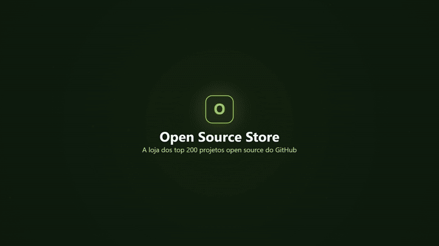
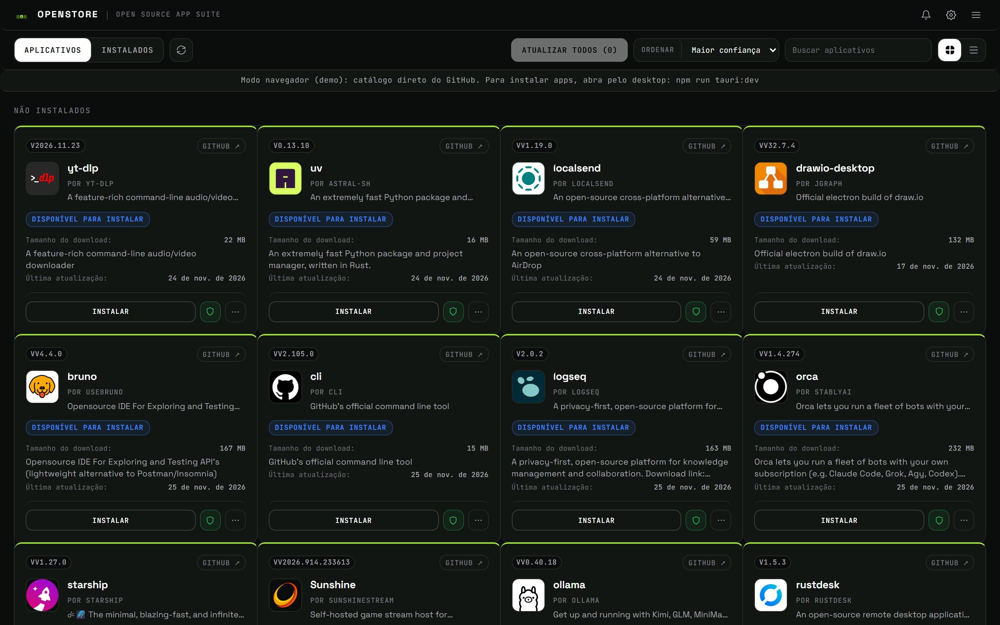
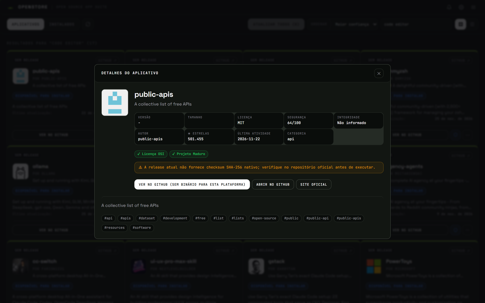
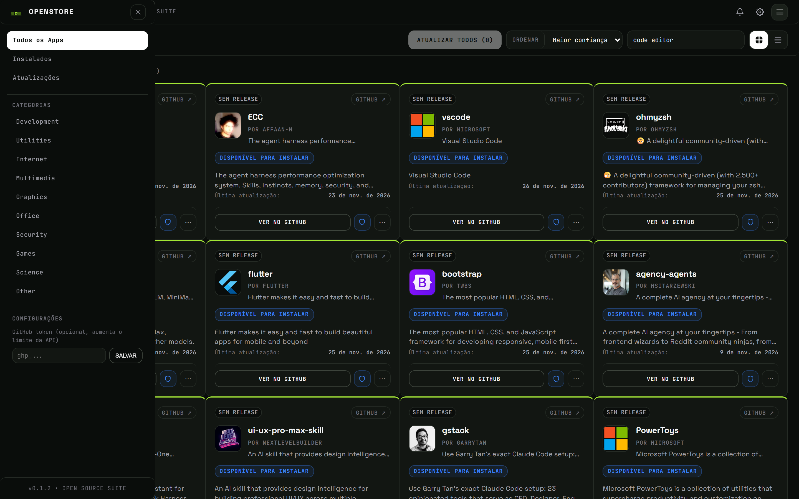
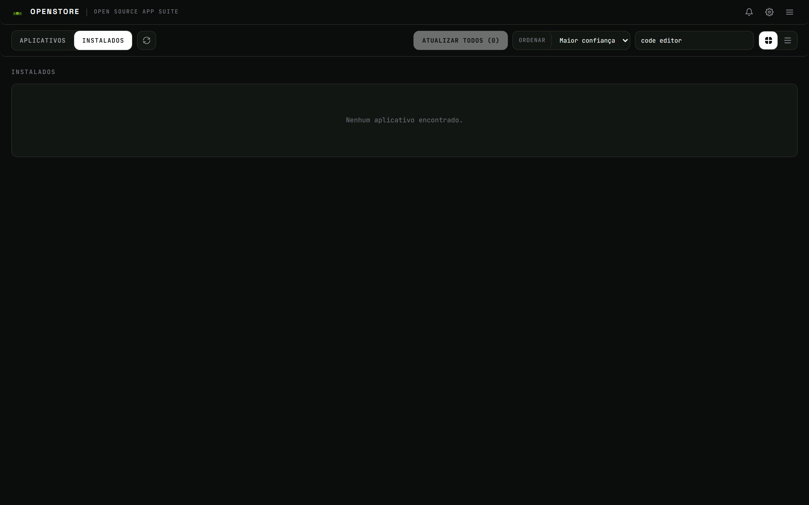
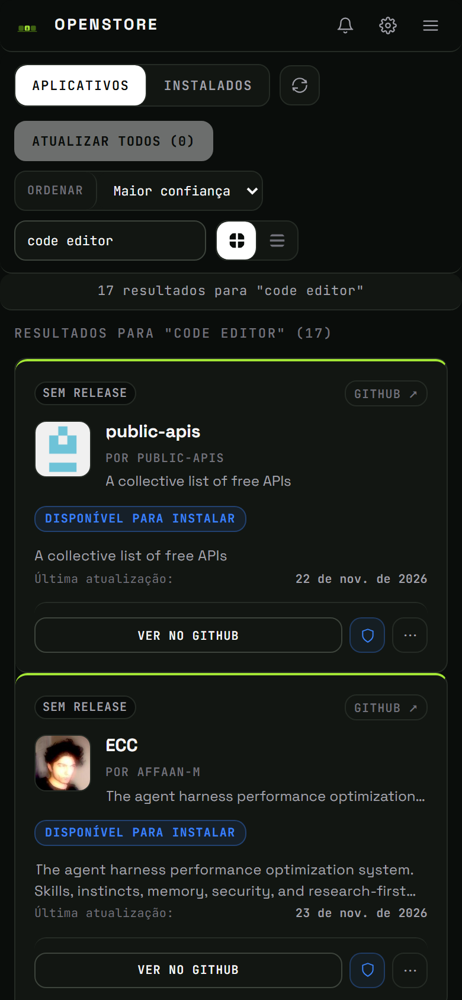

# Open Source Store

[](https://github.com/marlonferreira1800-hue/open-source-store/actions/workflows/ci.yml)
[](https://github.com/marlonferreira1800-hue/open-source-store/actions/workflows/pages.yml)
[](https://github.com/marlonferreira1800-hue/open-source-store/releases/latest)
[](LICENSE)
[](https://marlonferreira1800-hue.github.io/open-source-store/)

Uma loja centralizada de aplicativos **open source** (app store alternativa): em vez de procurar repositório por repositório no GitHub, você busca, instala e atualiza tudo de um só lugar.

**100% Rust no backend** com [Tauri 2.0](https://tauri.app) e interface modular em Vite + JavaScript vanilla.


## Demo em vídeo

<video src="https://raw.githubusercontent.com/marlonferreira1800-hue/open-source-store/main/brag/brag-hq-1080p.mp4" controls muted loop width="960" poster="docs/assets/demo-cover.png">
  Seu navegador não suporta vídeo HTML5 — <a href="brag/brag-hq-1080p.mp4">baixe o MP4</a>.
</video>



**Vídeos completos** (60fps): [1080p](brag/brag-hq-1080p.mp4) · [1440p](brag/brag-hq-1440p.mp4) · [vertical 9:16](brag/brag-hq-vertical.mp4) — na pasta [brag/](brag/).

## Prévia (screenshots)

Screenshots reais da interface — dá para ver como é o projeto **sem instalar nada**. Foram capturados da versão web (`npm run dev`, servida em `localhost:1420`) com o catálogo ao vivo consultando a API pública do GitHub. As imagens ficam em [`docs/screenshots/`](docs/screenshots/).



**Catálogo de apps**: a página inicial traz os apps curados (yt-dlp, uv, LocalSend, Logseq, Ollama...) com versão da release, tamanho do download, status "DISPONÍVEL PARA INSTALAR" e score de segurança. A barra de busca consulta a **API pública do GitHub em tempo real** para pesquisar qualquer outro repositório open source.



**Página de detalhes**: modal com os metadados completos do app — versão, tamanho, licença, autor, estrelas, score de segurança, verificação de integridade (SHA-256), flags de segurança, tags e as ações (instalar no desktop, abrir no GitHub, site oficial).



**Menu lateral**: navegação por categorias (Development, Utilities, Internet, Multimedia etc.) e a configuração opcional de um token do GitHub para ampliar o limite de requisições da API.



**Aba INSTALADOS**: no app desktop, lista os apps instalados com ações de ABRIR / ATUALIZAR / Desinstalar. Na versão web (só navegador) ela fica vazia, porque instalar exige o app desktop — e a interface avisa isso.



**Responsivo**: a mesma interface se adapta a telas de celular (viewport de 390px), com tabs, busca e cards em coluna única.

## Download

Baixe o instalador na página de [Releases](https://github.com/marlonferreira1800-hue/open-source-store/releases/latest):

| Plataforma | Arquivo |
|---|---|
| Windows (x64) | [`OpenStore_0.1.3_x64-setup.exe`](https://github.com/marlonferreira1800-hue/open-source-store/releases/download/v0.1.3/OpenStore_0.1.3_x64-setup.exe) (2,4 MB) |

O histórico completo de versões e suas mudanças está em [`CHANGELOG.md`](CHANGELOG.md) e na página de [Releases](https://github.com/marlonferreira1800-hue/open-source-store/releases).

## Versão Web (sem instalar nada)

Abra direto no navegador: **https://marlonferreira1800-hue.github.io/open-source-store/**

Publicada automaticamente no **GitHub Pages** a cada push na `main` (workflow [`pages.yml`](.github/workflows/pages.yml)). No modo web, o catálogo inicial vem do snapshot curado [`data/catalog-seed.json`](data/catalog-seed.json) (não consome rate limit) e a busca ao vivo funciona direto pela **API pública do GitHub** — sem baixar o app desktop. Instalar/atualizar apps continua exigindo o [app desktop](#download), e a interface avisa quando um recurso é exclusivo do desktop.

## Como funciona

1. O backend Rust consulta a **API do GitHub** (`/repos/{owner}/{repo}` + `/releases/latest`) para os repositórios curados em [`data/curated.json`](data/curated.json).
2. Para cada release, [`platform.rs`](src-tauri/src/platform.rs) **escolhe o asset compatível com seu sistema operacional e arquitetura** (`.msi`/`.exe` no Windows, `.AppImage`/`.deb` no Linux, `.dmg` no macOS).
3. O catálogo fica em **cache local** (`catalog_cache.json`, TTL de 30 min) para evitar estourar o rate limit da API.
4. O download ocorre em Rust com **progresso em tempo real** via evento Tauri (`download-progress`) e verificação **SHA-256** quando informada pelo GitHub.
5. Apps baixados são registrados em `installed.json` — exibindo **INSTALADOS**, **NÃO INSTALADOS**, **ABRIR**, **ATUALIZAR** e **Desinstalar**.
6. Busca ao vivo: qualquer repositório open source do GitHub pode ser pesquisado pela barra de busca (`search_apps`).

## Estrutura do Repositório

```text
open-source-store/
├── .github/
│   ├── ISSUE_TEMPLATE/             # Templates de bug, feature, sugestão de app + config.yml
│   ├── workflows/
│   │   ├── ci.yml                  # CI (Build Vite + cargo fmt/clippy/test)
│   │   └── pages.yml               # Deploy automático da versão web no GitHub Pages
│   ├── PULL_REQUEST_TEMPLATE.md
│   ├── SECURITY.md                 # Política de segurança e reporte privado
│   ├── FUNDING.yml                 # Botão de sponsoring
│   └── social-preview.png          # Imagem de pré-visualização social (Settings → Social preview)
├── data/
│   ├── categories.json             # Categorias da loja
│   ├── curated.json                # Seed curada de repositórios (owner/repo)
│   ├── catalog-seed.json           # Dados iniciais do catálogo
│   └── curation-policy.json        # Política de curadoria (5 portões)
├── docs/
│   ├── ARCHITECTURE.md             # Visão detalhada da arquitetura
│   ├── CATALOG_AUDIT.md            # Auditoria do catálogo
│   └── screenshots/                # Prints reais da interface (embutidos na seção "Prévia" do README)
├── scripts/
│   ├── copy-assets.mjs             # Copia web/assets/icons para dist/
│   ├── fetch-top100.mjs            # Atualiza data/curated.json via GitHub Search API
│   └── gen-icons.py                # Gera ícones padrão do app
├── src-tauri/                      # Backend desktop (Tauri 2.0 + Rust)
│   ├── capabilities/default.json   # Permissões (core, opener)
│   ├── icons/                      # Ícones do executável/bundle
│   ├── src/
│   │   ├── main.rs                 # Setup, plugins e registro de comandos
│   │   ├── commands.rs             # Handlers #[tauri::command]
│   │   ├── catalog.rs              # Integração com GitHub API + cache
│   │   ├── downloader.rs           # Streaming, progresso e SHA-256
│   │   ├── platform.rs             # Seleção de asset por OS/arch + testes
│   │   ├── store.rs                # Persistência JSON local
│   │   └── models.rs               # Structs serde
│   ├── Cargo.toml
│   └── tauri.conf.json
├── web/                            # Frontend WebView (Vite)
│   ├── assets/icons/               # Ícone fallback padrão
│   ├── src/
│   │   ├── api/client.js           # IPC Tauri + fallback navegador
│   │   ├── state/store.js          # Estado global, filtros e ordenação
│   │   ├── styles/style.css        # Estilos da interface
│   │   ├── ui/render.js            # Renderização de cards, modais e sidebar
│   │   ├── utils/format.js         # Sanitização (XSS), URL segura e formatação
│   │   └── main.js                 # Entrypoint e binding de eventos
│   └── index.html
├── .editorconfig
├── .gitignore
├── CHANGELOG.md                    # Histórico de versões e mudanças
├── CODE_OF_CONDUCT.md
├── CONTRIBUTING.md
├── LICENSE
├── package.json
├── README.md
└── vite.config.ts
```

## Executando o Projeto

Pré-requisitos: **Rust** (stable >= 1.77), **Node.js** (18+) e os [pré-requisitos do Tauri 2.0](https://v2.tauri.app/start/prerequisites/).

```bash
npm install
npm run tauri:dev      # Modo desenvolvimento (Vite + Tauri desktop)
npm run tauri:build    # Gera executável e instaladores
```

### Scripts disponíveis

| Script | Descrição |
|---|---|
| `npm run dev` | Sobe apenas o frontend Vite em `localhost:1420` (modo demo) |
| `npm run build` | Compila o frontend em `dist/` e copia os assets |
| `npm run tauri:dev` | Inicia o app desktop completo em modo desenvolvimento |
| `npm run tauri:build` | Gera build de produção e instaladores |
| `npm run catalog:update` | Atualiza `data/curated.json` e `data/catalog-seed.json` com o catálogo curado (top 200+) |
| `npm run icons:generate` | Regenera `icon.png`, `icon.ico` e `app_default.png` |

### Testes do Backend Rust

```bash
cd src-tauri
cargo test
```

## Comandos Tauri (Frontend → Rust)

| Comando | Descrição |
|---|---|
| `get_catalog(force_refresh)` | Carrega catálogo (cache local ou GitHub) |
| `search_apps(query)` | Busca ao vivo no GitHub |
| `get_categories()` | Lista categorias da loja |
| `get_app_by_id(app_id)` | Detalhes de um app específico |
| `download_app(app_id)` | Download com evento `download-progress` e SHA-256 |
| `cancel_download(app_id)` | Cancela download em andamento |
| `get_installed()` | Lista apps instalados |
| `get_apps_to_update()` | Lista apps com nova release disponível |
| `open_installed(app_id)` | Abre o aplicativo instalado |
| `uninstall_app(app_id)` | Remove o arquivo baixado e o registro |
| `open_url(url)` | Abre URL externa no navegador padrão |
| `save_github_token(token)` | Salva token opcional para ampliar o rate limit |
| `get_downloads_path()` | Retorna o diretório local de downloads |

## Documentação e Contribuição

- Arquitetura técnica: [`docs/ARCHITECTURE.md`](docs/ARCHITECTURE.md)
- Guia de contribuição: [`CONTRIBUTING.md`](CONTRIBUTING.md)
- Licença: [MIT](LICENSE)
